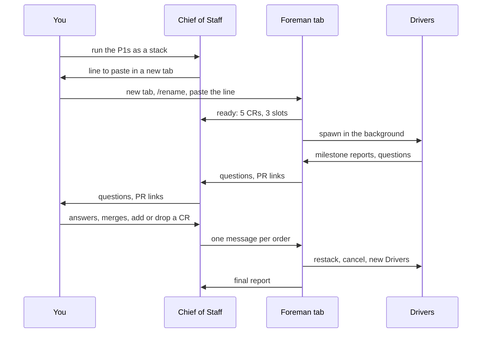
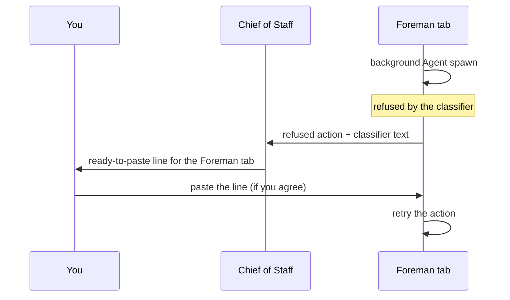

# A change-request factory with the Foreman next door: design 3

[TOC]

- **Spikes:** three ran on 2026-10-28; five remain before building ({ref}`sec-spikes`).
- **Follows:** [design 2](../design-2/01-design.md). Its roles, names, agent files and the `crf`
  tool are kept. Design 3 settles where the Foreman runs.
- **Evidence:** run 7 of the Studio factory on 2026-10-28 (section 1.1), the spikes of the same
  day ([evidence/spikes-2026-10-28.md](evidence/spikes-2026-10-28.md)), and the measured weeks
  of design 2 ([design-2/evidence/](../design-2/evidence/)).
- **Target:** the generic skill
  [change-request-factory](../../../../../../.claude/skills/change-request-factory/SKILL.md)

:::{important} Goal and verdict
Run the **Foreman in its own session, beside your Chief of Staff**, not as a subagent of it. In
VS Code that is a second Claude tab. You name it, and the two sessions find each other by that name.
The Foreman owns every Driver; you keep talking only to the Chief of Staff.

Measured on 2026-10-28 against the naive tree, where the Foreman is a subagent of your session:

- **Reachable:** the Foreman answered in 3 s with four Drivers running, and 32 of 32 messages
  arrived. In the naive tree the median was 8.5 min, and 14 of 89 never arrived.
- **Cheaper to wake:** every Foreman write is a one-hour cache write, so a wake within the hour
  reads its context instead of rebuilding it.
- **Flexible:** a new series of CRs started 3 s after the request; `TaskStop` cancelled a CR and
  killed its background shell.

Moving the Foreman alone saves **$60–92 a week**, 5 to 7 % of about $1,325. With design 2's
other levers the total is **$217–416 a week**, 16 to 31 %, in line with design 2's $222–413:
a tab costs no more than a background session. One step is manual: you open and name the
Foreman's tab, once per batch.
:::

## Terms

Chief of Staff
: Your main session. It talks with you, grills, steers the batch, and never owns a Driver. It
  may start short explorers to read code and docs for the grill.

Foreman
: Today's orchestrator. It owns one batch and every Driver of it.

Driver
: A background subagent, one per CR. It runs the rounds, ships the PR and watches CI.

Coder, Inspector
: The Driver's foreground subagents, one round each. The Inspector was called reviewer.

Main conversation
: The top-level conversation of a session, the one a person types in. Only a main conversation
  spawns subagents in the background, keeps a one-hour cache and runs `/loop`.

Naive tree
: The layout used up to run 7: the Foreman is a subagent of your session and spawns the Drivers.

Agent file
: A Markdown file in `.claude/agents/`, such as `driver.md`, that defines one kind of subagent
  ([sub-agents](https://code.claude.com/docs/en/sub-agents)). Its YAML front matter sets the
  model, the allowed tools, compaction and cache; its body holds the agent's standing
  instructions. The Foreman starts a Driver by asking for the `driver` type.

## 1. What the naive tree does, and what the spikes showed

### 1.1 The naive tree, measured

In the naive tree the Foreman is a subagent of your main session, and it spawns the Drivers.
Ten days of runs (design 2, section 1) and run 7 on 2026-10-28 show the same structural problem:

| Observation | Evidence | Consequence |
| --- | --- | --- |
| A subagent that spawns agents waits for them | 783 of 783 such spawns returned only with the child's report | the Foreman sits inside one open call while its Drivers run |
| Messages to the Foreman wait for that call | 89 messages: median 8.5 min, p90 2.5 h, 14 never arrived | your steering arrives late or not at all |
| The Foreman can stall unseen | run 7: 1 h 25 with three Drivers' work pending; the Chief of Staff noticed by hand | silence is not visible |
| Children's completions reach your session | run 7: a Driver's notice and hand-back went to the Chief of Staff, not the Foreman | your session relays: 43 % of its cost, $85 a week |
| The Foreman's cache lasts 5 minutes | rebuild writes are 60 % of its $89 a week | most wakes pay a full rebuild |
| Stopping the Foreman leaves its Drivers running | run 7; Claude Code issue [#95138](https://github.com/anthropics/claude-code/issues/95138) | no clean restart |

### 1.2 The spikes of 2026-10-28

Three short runs with a Foreman in a second VS Code tab and Haiku Drivers doing timed waits. The
full tables are in [evidence/spikes-2026-10-28.md](evidence/spikes-2026-10-28.md).

| Question | Measured | Verdict |
| --- | --- | --- |
| Do two tabs find each other by name? | `ListAgents` lists the Foreman under its `/rename` name | yes |
| Is the Foreman reachable under load? | 4 Drivers running; answer in 3 s; 32 of 32 messages arrived | yes |
| Do Driver reports reach the Foreman? | 25 reports, 9 notices and 4 hand-backs, all in the Foreman's tab | yes |
| Cache lifetime? | Foreman: only one-hour writes. Drivers: only 5-minute writes; a wake after 5 min 44 s rewrote 21k of 33k tokens, one after 4 min 30 s wrote 453 | 1 h and 5 min |
| Can a waiting Driver be steered? | "stop" woke it at once; it ended after its round | yes |
| Can a Driver inside a Coder round be steered? | a ping waited 2 min 56 s, until the foreground Coder returned | after the round, as today |
| Add a series of CRs mid-run? | two Drivers spawned 3 s after the request | yes |
| Cancel a CR mid-run? | `TaskStop` ended the Driver; its `sleep 241` was gone 9 s later | yes, with its shells |
| Can a Driver start a background Coder? | the child ran in the foreground, without an error | no; foreground only |
| Can a Coder wait on a background shell? | the shell was killed when the Coder ended its run | no |

## 2. The design in one picture

:::{figure} diagrams/two-sessions.svg
:label: fig-two-sessions
:alt: Two sessions found by name, each with a one-hour cache: the Chief of Staff, which you talk to and which starts short explorers for the grill, and the Foreman, named foreman-run-8. The Foreman owns the Drivers, background subagents with a five-minute cache or one hour through their agent file. Each Driver runs a Coder and an Inspector in the foreground, one round at a time, with a five-minute cache. At depth 3, freed, a Coder can spawn its own helper again.

The Chief of Staff and the Foreman are both main conversations; only the Foreman owns Drivers.
:::

| Role | Runs as | Model | Cache | Owns | Waits |
| --- | --- | --- | --- | --- | --- |
| Chief of Staff | your tab, named `cos-<project>` | Opus | 1 hour | short explorers for the grill | for you; idle notices from the Foreman |
| Foreman | a second tab, named `foreman-<batch>` | Opus | 1 hour | every Driver of the batch | idle; `/loop` tick at 59 min |
| Driver, stack Driver | background subagent of the Foreman | Sonnet; Opus on escalation | 1 hour from its agent file, else 5 min | one Coder or Inspector at a time | `crf wait` in the background |
| Coder, Inspector | foreground subagent of a Driver | Sonnet; Opus on escalation | 5 minutes | nothing | fast gates only |

One rule holds the design together: **only a main conversation owns live background agents.**
The Chief of Staff and the Foreman are main conversations. Below them, an agent only owns a
foreground child, for one round.

## 3. Why the Foreman goes next door

:::{figure} diagrams/naive-vs-tab.svg
:label: fig-naive-vs-tab
:alt: Three timelines. Naive tree: the Foreman sits in one long open call while its Drivers run, and three messages queue until it returns. Design 3: the Foreman makes short turns with idle gaps, and each message starts a turn. Both: a Driver in a foreground Coder round reads a message only when the round ends.

An agent reads a message only between two tool calls.
:::

The documentation states the cause. "By default the spawning subagent waits for each nested
subagent's report"
([sub-agents](https://code.claude.com/docs/en/sub-agents#let-subagents-spawn-their-own-subagents)).
A message to another session is read "between tool calls during an active turn. When the
receiving session is idle, Claude Code starts a new turn with the message"
([cross-session messaging](https://code.claude.com/docs/en/cross-session-messaging)).

A Foreman in its own session changes four things, all measured on 2026-10-28:

- **Its Drivers run in the background.** It is a main conversation, so its spawns return at once
  and it never sits inside an open call. The VS Code documentation says the same: "Spawned by the
  main agent: the subagent started in the background, so Claude isn't waiting for it"
  ([VS Code](https://code.claude.com/docs/en/vs-code#the-run-in-background-action-is-missing-under-a-subagent)).
- **Messages arrive in seconds.** Idle, it starts a turn; busy, it reads the message after the
  current tool call.
- **Its children report to it.** Driver reports, "waiting" notices and hand-backs land in the
  Foreman's tab, not yours.
- **Its cache lasts an hour.** On a subscription the main conversation writes one-hour cache by
  default ([prompt caching](https://code.claude.com/docs/en/prompt-caching)). With an API key,
  set `promptCacheTtl` to `1h`.

The Foreman also frees one level of depth: Drivers at depth 1, Coders at depth 2.

### 3.1 A tab first, a background session later

| | VS Code tab | `claude` in `tmux`, same machine | `claude --agent foreman --bg` |
| --- | --- | --- | --- |
| Started by | you: new tab, `/rename`, one pasted line | you: `tmux new -s foreman-<project>`, then `claude --name foreman-<project>` and the pasted line | the Chief of Staff, with Bash |
| Visible | as a tab you can read | `tmux attach -t foreman-<project>` | with `claude agents` or `claude attach` in a terminal |
| Survives | while VS Code runs | VS Code restarts and closed terminals; not a reboot | without any window; stopped after about 1 h idle and unattached unless pinned |
| Agent file | no: the `agent` setting would apply to the Chief of Staff too, so the Foreman starts from the skill | yes, `--agent foreman` | yes |
| Messaging | same machine, `notify_when_idle` works | same machine, `notify_when_idle` works | same machine |
| Prefix measured | 37k tokens | not measured | not measured |
| Status | spiked on 2026-10-28; **allowed** | **allowed, preferred for long runs** | design 2, spike 1 |

**Decision, 2026-10-28: the Foreman is an interactive Claude Code session on the same machine as
the Chief of Staff:** a VS Code tab, a Claude Code terminal, a Desktop app session, or a terminal
inside `tmux`. Any of them keeps messaging local, so `notify_when_idle` works and no Remote Control
is needed, and your authorizing lines are typed in the Foreman's own session.

- **`tmux` for long runs.** On that day a VS Code restart stopped the Foreman's tab and its Drivers
  ({ref}`sec-recovery`). A Foreman in `tmux` outlives the editor.
- **A machine reboot stops any of them.** The liveness check covers that case.
- **A Foreman on another machine** stays an option ({ref}`sec-remote-foreman`).

(sec-remote-foreman)=
### 3.2 A Foreman on another machine

The Chief of Staff is only an interface: the batch lives in the Foreman and in `crf`. The Foreman
can therefore run on an always-on machine while your laptop sleeps, goes offline or restarts VS
Code. Night runs no longer need your Mac awake, and a restart of your editor no longer stops the
batch ({ref}`sec-recovery`).

Everything below is from the
[cross-session messaging](https://code.claude.com/docs/en/cross-session-messaging) and
[Remote Control](https://code.claude.com/docs/en/remote-control) documentation, read on
2026-10-28. None of it is spiked yet.

**How the Foreman runs.** An interactive session with Remote Control, inside `tmux` on the remote
machine, in the target repository:

```bash
tmux new -s foreman-studio
claude --remote-control "Foreman studio"
```

- **Not `claude -p`.** A `-p` worker binds an inbox and receives messages from its own machine,
  but the documentation lists Remote Control only for server mode, interactive sessions and
  `/remote-control`. A `-p` session also cannot show an approval dialog, and you could not type
  the authorizing lines of {ref}`sec-classifier` into it.
- **Not server mode** (`claude remote-control`) for a long batch: after an extended network outage
  it "gives up after roughly 10 minutes" and exits, while an interactive session reconnects by
  itself.
- **`tmux` or `screen`**, because "if you close the terminal … the session goes offline".

**How the two sessions talk.** Remote Control on the Foreman alone is not enough:

| Requirement | Why |
| --- | --- |
| Remote Control on the Foreman | a session on another machine is listed only "when it runs with Remote Control" |
| Remote Control on the Chief of Staff too (`/remote-control`) | it lists sessions on other machines only while "connected as well"; without it, its messages go out "without a reply address" and the Foreman cannot answer |
| A claude.ai login on both machines | Remote Control needs a subscription login; API keys, Bedrock, Agent Platform, Foundry and an `ANTHROPIC_BASE_URL` proxy are not supported |
| Both sessions in the same permission class | otherwise messages are held; a VS Code tab cannot show the approval dialog and drops a held message after five minutes |
| `gh` signed in, `uv`, `node` and git keys on the remote machine | the Foreman and its Drivers push, open PRs and run gates there |

Messages between the two travel through Anthropic servers. To approve each one leaving your
laptop, set `isolatePeerMachines`.

**What changes for the Chief of Staff.**

- **Liveness check.** `notify_when_idle` works only "to your sessions on this machine". For a
  remote Foreman, the check of {ref}`sec-recovery` uses the listing, where a dropped connection
  shows as `offline`, and a ping with a reply.
- **Offline in both directions.** A message to an `offline` session "arrives only after that
  session's machine reconnects". The Foreman's reports and questions therefore queue while your
  laptop sleeps. The Foreman keeps working on everything that does not need you and applies its
  night policy card.
- **Back online.** The Chief of Staff reads the queued messages and `crf status` before it reports
  to you.
- **Your authority.** The lines you paste for the classifier go into the Foreman's session through
  claude.ai/code or the Claude app, which are windows onto it.

## 4. A batch from start to end



1. **You ask the Chief of Staff** for a batch: "run the P1s as a stack".
2. **The Chief of Staff prepares it.** It grills you if needed, runs `crf open`, and writes the
   batch brief. It then prints one line for you:

   ```text
   New Claude tab → /rename foreman-run-8 → paste:
   /change-request-factory foreman run-8 --cos cos-studio
   ```

3. **You open the tab**, about 30 seconds. The Foreman reads the brief and `crf status`, starts
   its `/loop` tick, and sends `ready: 5 CRs, 3 slots` to `cos-studio`. The pasted line is typed
   by you in the Foreman's tab, so it carries your authority there ({ref}`sec-classifier`): the
   Foreman's mission must never arrive only as a message from the Chief of Staff.
4. **The Foreman spawns the Drivers** in the background, within `crf slots`, and records each
   CR's agent ID with `crf agents set`. The `Agent` tool takes no name, so the ID is the address.
5. **Each Driver works its CR.** It runs the Coder and the Inspector in the foreground, ships with
   `crf ship`, waits for CI with a background `crf wait`, and sends the Foreman one short report
   per milestone: PR opened, CI result, blocked, a question for you.
6. **You steer through the Chief of Staff.** "Add item 812", "drop CR 104", "CR 103 first": the
   Chief of Staff sends one message to the Foreman. The Foreman spawns, cancels with `TaskStop`
   and `crf cancel`, or reorders, and confirms.
7. **Questions go up as messages:** Driver → Foreman → Chief of Staff → you, and the answer
   comes back the same way. A state file is a record, not a channel.
8. **PRs are ready.** The Foreman sends the stack with links. You merge, or ask the Chief of
   Staff to. The Chief of Staff tells the Foreman, which has the stack Driver restack the rest.
9. **At night,** the Foreman's `/loop` tick and its policy card take the routine decisions (design
   2, section 4.3). Anything else waits in a morning report to the Chief of Staff.
10. **Landing.** The Foreman runs `crf land`, sends the final report, stops its tick and says its
    tab can be closed.

## 5. The parts

### 5.1 Chief of Staff

- **Keeps:** the conversation, the backlog, the grill, priorities, your decisions, reports,
  merges you ask for, and the demo tour.
- **Explores for the grill.** It may start background explorers that read code, docs or issues
  and come back in minutes, so its questions to you are precise. They report to it, as children
  of a main conversation; it never starts a Driver.
- **Starts each batch** with `crf open`, the brief and the line to paste.
- **Steers** with one message to the Foreman per order, and reads `crf status` for status.
- **Stops doing:** owning Drivers, relaying their reports, reading the Foreman's files,
  restarting agents. That was $85 a week of your main session.
- **Watches the Foreman:** `SendMessage` with `notify_when_idle` after each order, and a stale
  heartbeat in `crf status` flags a silent Foreman.
- **Guards recovery after an interruption.** After a VS Code restart, an extension update or its
  own cold start, it proves that the Foreman's session is alive before reporting any progress,
  finds the Drivers that died, and gives you the line that resumes the batch
  ({ref}`sec-recovery`).
- **Has a fixed name.** Rename its tab once, for example `cos-studio`, so the Foreman's brief
  can name it.

### 5.2 Foreman

- **Owns the batch:** spawns Drivers, reads their reports, decides across CRs, restacks after
  merges, lands. It keeps the CR → agent ID map in `crf agents`.
- **Never waits inside a call.** Its Drivers run in the background; its own waits are background
  `crf wait` calls.
- **Keeps a small context:** reports of about 300 tokens, `crf status` instead of files, and
  compaction at 100k tokens through `autoCompactWindow`.
- **Ticks from state, not memory.** In spike 2, two of four ticks were stale: a Driver report
  arrived during the tick's own turn. A tick reads `crf status`.
- **Takes orders from the Chief of Staff.** In its own tab it acts on three things you type: the
  start line, an authorizing line the Chief of Staff gave you ({ref}`sec-classifier`), and "stop"
  or "pause". It tells the Chief of Staff each time. To anything else it answers in one line:

  > I run batch run-8 for cos-studio. Please give orders there, so the batch has one place for
  > decisions. Here I only take the start line, the lines cos-studio gives you to paste, and
  > "stop" or "pause".

- **Night policy card**, as in design 2: one extra round per CR, a red PR moved to the top,
  `crf stack bisect` before any new round, infrastructure re-runs within a budget.

### 5.3 Drivers

- **One per CR**, plus the stack Driver; background subagents of the Foreman.
- **Coder and Inspector in the foreground.** A Driver's background spawn becomes foreground
  anyway, and a Coder cannot wait on a background shell. Long suites therefore run in the Driver
  with `crf gate --long`, as design 2 says.
- **Reports by message.** `SendMessage` to `main` at each milestone, under 300 tokens.
- **Waits with a one-hour cache.** The Driver agent file sets `experimental.cacheTtl: 1h` and
  `crf wait --max 3300`. Each re-arm of a 5-minute wait costs a Driver turn and a Foreman turn
  ({ref}`sec-wait`). Spike 1 must show that the field applies.
- **Reachable between rounds.** During a Coder round, a message waits for the round to end. An
  urgent stop uses `TaskStop`.

```{code-block} yaml
:caption: .claude/agents/driver.md, front matter only. Field names from the sub-agents reference.

---
name: driver
description: Drives one change request through rounds, ship, CI and hand-back.
model: sonnet
tools: Agent, Bash, Read, Grep, Glob, SendMessage
autoCompactWindow: 100000
background: true
experimental:
  cacheTtl: 1h
---
```

### 5.4 Coder and Inspector

Unchanged from design 2: agent files with a tool allowlist, a fresh Coder per round with a
hand-over note, fast gates only, 5-minute cache. They must not run `sleep`: the harness refuses
a long foreground `sleep`, and a background shell dies when the Coder ends its run.

### 5.5 What `crf` gains

Design 2's `crf` commands stay. The spikes add three:

| Command | Does | Why |
| --- | --- | --- |
| `crf agents set\|get <cr> [<id>]` | the CR → agent ID map | the `Agent` tool has no name parameter |
| `crf cancel <cr>` | `TaskStop` by the Foreman, then kills the CR's process group and worktree jobs | a cancelled CR must not leave suites or CI watchers behind |
| `crf heartbeat` | the Foreman's last turn and the age of its oldest unanswered message | a stall shows in `crf status` within one tick |

## 6. Costs

### 6.1 What wakes the Foreman

Measured over spikes 2 and 3, Opus 5.5, with the Foreman's context between 37k and 90k tokens:

| Trigger | Foreman cost per trigger |
| --- | --- |
| A Driver's "waiting on its own background work" notice | $0.018 |
| A Driver's completion or stop | $0.022 |
| A Driver report by message | $0.032 |
| A cron tick that sends a status line | $0.050 |
| An order from the Chief of Staff, with spawns | $0.14 |

Every one of these is a cache read of the Foreman's context, not a rebuild. In the naive tree, a
wake after more than 5 minutes rewrote the whole context at 1.25 times the input price.

(sec-wait)=
### 6.2 A Driver's wait

:::{figure} diagrams/cache-and-waits.svg
:label: fig-cache
:alt: Left, measured: a Driver woken after 4 minutes 30 seconds read 33,352 tokens and wrote 453; woken after 5 minutes 44 seconds it read 11,668 and wrote 21,002. Right, estimated for a 30-minute CI wait of a Sonnet Driver with an Opus Foreman at 100k tokens each: re-arming every 4.5 minutes costs 0.25 dollars, waking cold 0.28, and a one-hour Driver cache 0.04.

The five-minute rule, measured, and what it means for a CI wait.
:::

A background Driver that ends a turn while its own command still runs sends its parent a
"waiting" notice, and the Foreman spends a turn on it. Design 2 counted re-arms every 4.5 minutes
as cheap Driver turns only. Each one also wakes the Foreman, for about $0.02.

For one 30-minute CI wait, at 100k tokens of context:

| Strategy | Driver | Foreman | Total |
| --- | --- | --- | --- |
| 5-minute cache, re-armed every 4.5 min | 7 warm turns, $0.09 | 7 notices, $0.16 | $0.25 |
| 5-minute cache, cold wake | 1 rebuild, $0.25 | 1 notice, $0.02 | $0.28 |
| One-hour cache, one wake | 1 warm turn, $0.01 | 1 notice, $0.02 | $0.04 |

The one-hour cache makes every Driver write cost 2 times the input price instead of 1.25, about
$0.15–0.25 more per CR; one wait over about ten minutes pays it back. Design 2's per-role
simulation found the two strategies equal within $2 a week. Adding the Foreman notices, which it
did not count, the one-hour Driver cache saves about $2–7 a week. Two gains are not counted: no
re-arm loop in any Driver, and no Driver rebuild after a Coder round longer than five minutes,
which a re-arm cannot prevent because the Driver sits in the open `Agent` call.

### 6.3 Per week

Weekly figures at official prices, from design 2's evidence and the spikes. Dark bars are the
low case, light bars the high case:

```vega-lite
width: 560
height: 230
data:
  values:
    - {item: "Foreman cache, 5 min to 1 h", low: 39, high: 39}
    - {item: "Your session stops relaying", low: 48, high: 67}
    - {item: "Wakes for messages and reports", low: -20, high: -10}
    - {item: "Waiting notices from re-arms", low: -7, high: -4}
    - {item: "Design 2's other levers", low: 155, high: 317}
    - {item: "One-hour Driver cache", low: 2, high: 7}
    - {item: "Design 3, all levers", low: 217, high: 416}
encoding:
  y: {field: item, type: nominal, sort: null, title: null}
layer:
  - mark: {type: bar, color: "#C9E8CF"}
    encoding:
      x: {field: high, type: quantitative, title: "Saving per week, dollars"}
  - mark: {type: bar, color: "#46a758"}
    encoding:
      x: {field: low, type: quantitative}
```

```{list-table} Design 3 against the naive tree, per week
:header-rows: 1
:widths: 40 40 20

* - Change
  - Source
  - Saving
* - Foreman cache from 5 minutes to 1 hour
  - design 2 evidence: one-hour TTL alone on today's Foreman
  - **$39**
* - Your session stops relaying Driver reports and restarts
  - $85 of orchestration, less $18–37 of work the Foreman now does
  - **$48–67**
* - Wakes for messages and Driver reports, now read at once
  - design 2 estimate
  - −$10–20
* - "Waiting" notices from Driver re-arms
  - spikes: $0.018–0.023 each, 200 to 300 a week
  - −$4–7
* - **Foreman next door, alone**
  - **5 to 7 % of about $1,325**
  - **$60–92**
* - Design 2's other levers: `crf`, agent files, small contexts, workers
  - design 2, section 9
  - +$155–317
* - One-hour Driver cache instead of re-arm
  - section 6.2
  - +$2–7
* - **Design 3, all levers**
  - **16 to 31 %**
  - **$217–416**
```

The Foreman's prefix in a tab is 37k tokens, against about 34k for a subagent today. At one cache
read per turn, the difference is under $1 a week. The total matches design 2, because a tab and a
background session give the Foreman the same cache.

## 7. Flexibility

Adding, removing or reordering work mid-run was the point of keeping agents. Here is each move in
both trees, with what the spikes measured:

| Move | Naive tree | Design 3 |
| --- | --- | --- |
| Talk to the Foreman | waits for its open call: median 8.5 min | 3 s |
| Add a series of CRs | the order waits, or your session takes over the spawns | Drivers started 3 s after the request |
| Cancel a CR | your session finds the Driver and stops it | `TaskStop` by the Foreman; its shell gone within 9 s |
| Steer a waiting Driver | through the blocked Foreman | at once: the message wakes it |
| Steer a Driver in a Coder round | after the round | after the round; measured 2 min 56 s |
| Reorder the stack | through the blocked Foreman | one message; the Foreman restacks |
| Answer a Driver's question | often found late in a state file | message chain up to you and back |
| Restart the Foreman | its Drivers keep running, unowned | the tab keeps its conversation; compaction instead of rotation |
| Do something else meanwhile | your session is busy relaying | your session stays free |

Nothing is lost against the naive tree. Steering a Driver inside a Coder round stays bounded by
the round, as today.

## 8. Advantages and drawbacks

::::{grid} 1 1 2 2
:gutter: 2

:::{grid-item-card} Advantages
- The Foreman is never blocked, so your orders reach it in seconds.
- Drivers report to the Foreman. Your session stops relaying, and stays free for you.
- The Foreman's one-hour cache turns most wakes from rebuilds into reads.
- You can watch the Foreman work in its tab.
- It works today in VS Code, with no new Claude Code feature.
- One more level of depth: a Coder can delegate a search again.
:::

:::{grid-item-card} Drawbacks
- **One manual step per batch:** open a tab, rename it, paste a line. The Chief of Staff cannot
  open a VS Code tab.
- **Two tabs to keep open.** Closing VS Code stops the batch; a night run needs VS Code open and
  the Mac awake, as today.
- **No agent file for the Foreman in a tab.** It starts from the skill and carries the full tool
  list and `CLAUDE.md`: 37k tokens. Open its tab in the target repository's window, or it loads
  the wrong `AGENTS.md`.
- **Agent files must exist before the Foreman tab opens.** A session reads them at startup: a
  `driver.md` added or changed mid-batch is ignored until the tab restarts (measured 2026-10-28).
- **Same permission mode in both tabs.** If one bypasses permissions and the other does not,
  messages are held. A VS Code tab cannot show the approval dialog, and drops a held message after
  5 minutes.
- **Every Driver event costs a short Foreman turn,** $0.02–0.03. Small, but it scales with Drivers
  and re-arms.
- **Agent IDs, not names.** The Foreman keeps the map in `crf agents`.
- **Two people at the Foreman.** You might type in its tab. It sends you back to the Chief of
  Staff, except for the start line, pasted authorizations, "stop" and "pause".
:::
::::

## 9. Fallback without a second session: dispatch mode

Where a second session is not possible, as in Copilot CLI today, the Chief of Staff owns the
Drivers and the Foreman is a subagent that owns nothing. This was proven in run 7.

:::{note} How dispatch mode works
:class: dropdown

- The Foreman ends every turn with the Driver briefs to launch. It never calls `Agent`, never
  waits, and is resumed by a message.
- The Chief of Staff spawns the Drivers it asks for, sends it a "tick" every 30 minutes while a
  batch runs, and forwards Driver hand-backs it receives.
- Drivers report to the Foreman with `SendMessage`.
- Cost: the Foreman keeps a 5-minute cache and rebuilds at most wakes, and your session carries
  one brief per Driver. Use it for small stacks you follow live.
:::

## 10. Lessons from run 7 and the spikes, for agent files and briefs

- **Never delete environments.** No `rm -rf` on `.venv`, `node_modules` or caches. In run 7 that
  locked a Coder out of Bash; a locked agent is replaced by a fresh one with a resume brief.
- **No `sleep` in agents.** Waits go through `crf wait`, which a Driver runs in the background.
- **Per-worktree setup is part of `crf open`:** `npm ci`, `uv sync` and the browser install,
  approved once per batch.
- **Tools pinned to the project.** `crf gate` uses the project's own environment, not a global
  tool.
- **Private scratch files.** Each agent writes under its own folder. In run 7 one Driver amended a
  commit with another session's message file.
- **A known red check is reported, not fixed.** `crf ci classify` tags a failure that is also red
  on main.
- **Drivers on Sonnet, not Haiku.** In the spikes, Haiku Drivers started an extra wait and sent a
  reply without the requested time.
- **Authority comes from your own words in the Foreman's tab.** See {ref}`sec-classifier`.

(sec-classifier)=
### 10.1 Classifier refusals in the Foreman's tab

In auto mode, the permission classifier judges each action against what the user asked in that
conversation. A message from another session counts as a peer's request, never as yours, and a
peer cannot grant permissions.

Observed on 2026-10-28:

- The Chief of Staff handed the Studio's Foreman tab its mission by `SendMessage` only. The
  classifier refused the Foreman's first background `Agent` spawn, with no reason given, and a
  `git checkout -- <file>`, as "irreversible local destruction".
- You typed one paragraph in the Foreman's tab. The same spawn went through at once, with no
  change of permission mode.
- In the Chief of Staff's own session the same spawns had passed all day, because you had asked
  for the batch there. The one earlier refusal was a background spawn by a Driver, the agent
  furthest from your request.



:::{important} Rule on any refusal
The Foreman reports the refused action and the classifier's text. The Chief of Staff gives you a
line to paste in the Foreman's tab that names the action and its scope:

```text
I confirm: you are the Foreman of <project>. You launch the Drivers in the background,
and you may set aside with git stash the files left by a stopped Coder. Resume <task>.
```

The Chief of Staff never retries a refused action itself: that would launder the refusal.
:::

(sec-recovery)=
### 10.2 Recovery after an interruption

A VS Code restart stops every session at once: the Chief of Staff, the Foreman and every Driver
and Coder. The tabs come back with their conversations, but no agent resumes on its own. The
Chief of Staff owns the recovery and checks that it goes well.

Observed on 2026-10-28, after VS Code restarted during an extension update:

- The Foreman's session was no longer listed by `ListAgents`, and every `claude` process was under
  a minute old. Its Driver and Coder were gone.
- An orphan `test/visual/capture.py` kept running in the worktree for 7 minutes, with nobody to
  read its result.
- The Coder's 27 uncommitted files survived in the worktree.
- The Chief of Staff first reported the Foreman as working, from recently changed files in the
  worktree. Changed files and running processes do not prove that an agent is alive.

**Liveness check.** The Chief of Staff runs it at its own cold start, when you say you restarted,
when the heartbeat is stale, and before it reports progress after any pause:

1. **Session listed:** `ListAgents` shows the Foreman's session and whether it is busy or idle.
   Not listed means down.
2. **Ping:** `SendMessage` to the Foreman, "ping: reply with your `crf status` line", with
   `notify_when_idle`. Alive means a reply within about two minutes.
3. **Drivers:** the Foreman compares `crf agents` with its live agents. A CR marked working
   without a live Driver is orphaned.
4. **Orphan processes:** suites, browsers and CI watchers in a worktree whose agent is gone go to
   `crf cancel`.

**Resume.** If the Foreman is down, or alive with orphaned CRs, the Chief of Staff gives you a line
to paste in the Foreman's tab. You type it, so it carries your authority ({ref}`sec-classifier`):

```text
Resume. VS Code restarted and your Drivers were stopped. You are the Foreman of <project>:
relaunch in the background the Driver of each CR still marked working, from its STATE.md and its
worktree, keeping uncommitted work, and stop orphan processes. Then continue <task>.
```

After the resume, the Chief of Staff pings again and waits for the first report of each
relaunched Driver before it tells you the batch is running.

(sec-spikes)=
## 11. Spikes before building

Done on 2026-10-28 ([evidence](evidence/spikes-2026-10-28.md)):

- [x] Messaging between two tabs, by name.
- [x] Four Drivers in parallel under load.
- [x] Cache lifetime, blocked Drivers, adding and cancelling CRs mid-run.

To do, in this order:

- [ ] **Spike 1, Driver agent file.** A Driver started by the Foreman from
  `.claude/agents/driver.md` with `experimental.cacheTtl: 1h` shows one-hour writes and a first
  turn well below 34k tokens.
- [ ] **Spike 2, cancel during a Coder round.** `TaskStop` on a Driver whose foreground Coder is
  running stops the Coder and its processes too, or `crf cancel` must.
- [ ] **Spike 3, a long Foreman.** In a VS Code tab: compaction at 100k, an idle hour with the
  `/loop` tick, and a VS Code restart that resumes the tab and its Drivers. The Chief of Staff's
  liveness check must flag the stopped Foreman within one check.
- [ ] **Spike 4, one real batch.** Two or three CRs end to end with Sonnet Drivers; cost per CR
  against run 7.
- [ ] **Spike 5, dispatch mode on Copilot CLI.** The same agent files and `crf`; what the Foreman
  can receive.
- [ ] **Spike 6, a Foreman on another machine** ({ref}`sec-remote-foreman`). An interactive
  `claude --remote-control` Foreman in `tmux` on a second machine. The Chief of Staff, also on
  Remote Control, lists it, sends an order and gets a reply. The laptop sleeps for 30 minutes
  while one CR runs, and on waking the Chief of Staff receives the queued reports.

## 12. Risks

:::{warning} What could break design 3
- **Behaviour, not documentation.** Background spawns from a subagent becoming foreground, shells
  dying with a Coder, and the "waiting" notices were observed, not documented. A Claude Code
  release can change them; the spikes must be re-run on upgrade.
- **`experimental.cacheTtl` is experimental.** It applies only when no global subagent TTL is set,
  and not on usage credits. Without it, Drivers re-arm and pay the Foreman notices.
- **A closed tab or a VS Code restart ends the batch.** The state in `crf` lets the Foreman's
  tab pick it up, but its Drivers stop with it and leave orphan processes. The Chief of Staff's
  liveness check and resume line cover it ({ref}`sec-recovery`).
- **Haiku-like slips by Sonnet Drivers** in long runs are not measured yet; spike 4 measures them.
- **Classifier refusals in a Foreman tab.** An authorization not typed by you in that tab can be
  refused at any step ({ref}`sec-classifier`). One observation only; spike 4 should start the
  Foreman with the authorizing line and count refusals.
:::

## 13. Open questions

Each question carries a recommended answer.

1. **Who opens the Foreman?** Recommended: you, with the line the Chief of Staff prints. Move to
   `claude --bg`, started by the Chief of Staff, once design 2's spike 1 passes.
2. **Name of the Chief of Staff's tab?** Recommended: `cos-<project>`, set once with `/rename`.
3. **Driver cache?** Recommended: one hour from the agent file, if spike 1 passes. Otherwise a
   5-minute cache with re-arms.
4. **What may you say directly to the Foreman?** Recommended: the start line, the authorizing
   lines the Chief of Staff gives you, and "stop" or "pause"; it reports each to the Chief of
   Staff.
5. **Keep dispatch mode?** Recommended: only where a second session is not possible, such as
   Copilot CLI today.
