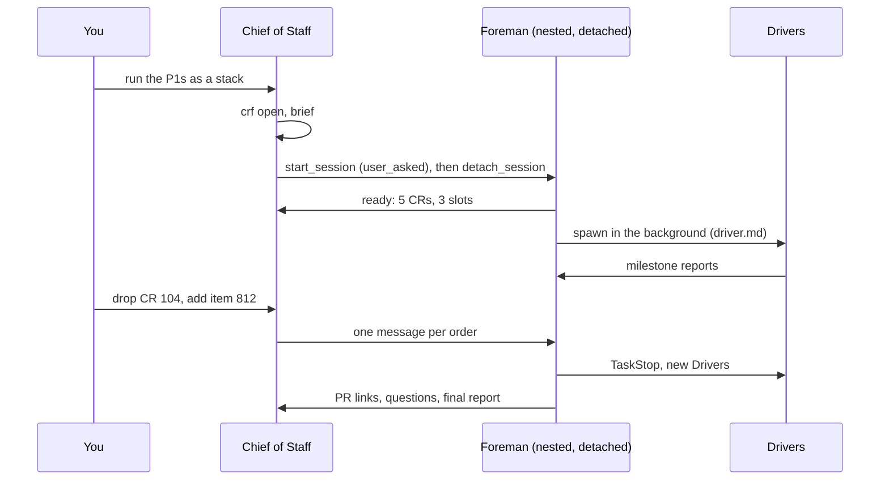

# A change-request factory with the Foreman in a nested session: design 5

[TOC]

- **Follows:** [design 3](../design-3-sibling-session/01-design.md). Its roles, `crf`, agent
  files and recovery rules are kept. Design 5 settles who starts the Foreman and how deep the
  tree can go.
- **Evidence:** two simulated batches on 2026-10-31 in Claude Desktop
  ([evidence/tests-2026-10-31.md](evidence/tests-2026-10-31.md)), the Copilot series 05–08 of
  [design 4](../design-4-copilot-cli/03-comparison-report.md), and the Copilot CLI 1.0.105
  changelog.
- **Not yet measured:** the Copilot variant with Drivers as subagents
  ({ref}`sec-copilot-probe`).
- **Optimized for Claude Desktop:** [02-cost-detail.md](02-cost-detail.md), five levers and the
  comparison with design 1's dynamic workflow.

:::{important} Goal and verdict
**The Chief of Staff starts the Foreman itself, as a nested session, and the Foreman owns its
Drivers as background subagents.** Both hosts allow exactly one level of nested sessions, so
that is the only shape that works on both.

- **Claude Desktop: works today.** The Chief of Staff starts the Foreman with `start_session`
  in the turn where you ask for the batch, then detaches it. No tab to open, no line to paste,
  and no classifier refusal in 14 spawns and 3 cancels. Drivers from an agent file get the
  one-hour cache: design 3's spike 1 passes.
- **Cost against design 3:** $4–7 a week more, from the larger Desktop prefix: a saving of
  **$210–412 a week** instead of $217–416. Left attached, the Foreman wakes the Chief of Staff
  after every turn and the saving drops to $180–403.
- **Copilot: plausible, one probe left.** The Foreman as a nested session is proven (series 06b);
  Drivers as multi-turn background subagents steered by `write_agent` are not. Estimated
  orchestration **$0.06–0.08 per CR**, against $0.12 for session Drivers and $0 for a dynamic
  workflow.
:::

## Terms

The roles are design 3's: Chief of Staff, Foreman, Driver, Coder, Inspector. Two terms are new.

Nested session
: A session started by another session's agent, shown under it in the sidebar. Claude Desktop
  calls it a linked session; Copilot's VS Code Agents host creates one with `create_session`.

Detach
: In Claude Desktop, `detach_session` moves a nested session to the top level. It keeps running
  and messaging, but its parent is no longer told when its turns end.

## 1. What changed since design 3

| Fact | Design 3 (2026-10-28) | Now (2026-10-31) |
| --- | --- | --- |
| Who opens the Foreman | you: new VS Code tab, `/rename`, pasted line | the Chief of Staff, with one tool call |
| Its mission | typed by you in the Foreman's tab, or refused | the brief of `start_session`; nothing refused in two runs |
| Deeper sessions | not tested | refused on both hosts: a nested session cannot start one |
| Driver cache | one hour, if spike 1 passes | **one hour, measured** with the agent file |
| Copilot | dispatch mode only (section 9) | a Foreman session with nested sessions works (design 4, series 06b) |

The one-level limit decides the shape. On Claude Desktop the app answered the Foreman's
`start_session` with "Start sessions only on the user's own words to you here". On Copilot, a
created session cannot create another one, as you observed. **Drivers are therefore subagents
of the Foreman, never sessions.**

## 2. The design in one picture

:::{figure} diagrams/two-hosts.svg
:label: fig-two-hosts
:alt: Two columns, Claude Desktop and Copilot. In each, the Chief of Staff at session level 0 starts the Foreman at session level 1, the only nested level. The Foreman owns Drivers as background subagents at depth 1; each Driver runs a Coder and an Inspector at depth 2. On Claude the Foreman is detached and the Drivers come from an agent file with a one-hour cache. On Copilot the Foreman runs on Sol without /every, and steers its Drivers with write_agent.

Sessions on the first two rows, subagents below. Neither host allows a third row of sessions.
:::

| Role | Claude Desktop | Copilot, VS Code Agents host |
| --- | --- | --- |
| Chief of Staff | your session, Opus, one-hour cache | your chat |
| Foreman | `start_session`, then `detach_session`; Sonnet at low effort ([02](02-cost-detail.md)), one-hour cache | `create_session`; `gpt-6.1-sol`, no `/every` |
| Driver | background subagent from `driver.md`, Sonnet, one-hour cache | `task` in background mode, multi-turn, custom agent `driver` |
| Coder, Inspector | foreground subagents of the Driver | sync subagents of the Driver, Luna custom agents |
| Orders | `SendMessage` to the Foreman's session id | `send_message` (`queue`, or `steer` when urgent) |
| Steering a Driver | `SendMessage` to its agent ID; `TaskStop` | `write_agent`; stop by message |

Design 3's rule still holds: **only a session owns live background agents.** Design 5 adds a
second one: **only you start sessions.** The Chief of Staff starts the Foreman in the turn where
you ask for the batch.

## 3. A batch on Claude Desktop



1. **You ask the Chief of Staff** for a batch. It grills you if needed, runs `crf open` and writes
   the brief.
2. **It starts the Foreman in that same turn** with `start_session`, `initiation: user_asked`,
   the brief as prompt, `use_worktree: false` in the target repository. The app allows it only
   because you asked in this turn: an order that reaches the Chief of Staff any other way must
   come back to you first.
3. **It detaches the Foreman at once.** Otherwise the app sends the Chief of Staff a note after
   every Foreman turn ({ref}`sec-notes`).
4. **The Foreman works as in design 3:** `/loop` heartbeat, Drivers in the background from
   `driver.md`, `crf agents set`, `TaskStop` and `crf cancel` for cancels.
5. **You steer through the Chief of Staff.** It sends one message per order. Orders sent while the
   Foreman is mid-turn wait for the turn to end: 15 to 54 s measured. They then arrive together
   and cost one Foreman turn.

### 3.1 What the tests showed

From [evidence/tests-2026-10-31.md](evidence/tests-2026-10-31.md), 14 Drivers over two runs:

| Question | Measured | Verdict |
| --- | --- | --- |
| Can the Chief of Staff start the Foreman? | yes, one call, in auto mode | no manual step left |
| Is the Foreman's mission refused? | 0 refusals: 14 background spawns, 3 `TaskStop`, ticks | the start brief carries your request |
| Can the Foreman start a session? | refused by the app | one level of sessions |
| How deep can subagents go? | Driver → subagent → subagent | enough for Coder helpers |
| Order latency | idle: 15 s; busy: 24–54 s | slower than a VS Code tab (3 s) |
| Driver report latency | 0–10 s | as in design 3 |
| Driver cache from an agent file | only one-hour writes; prefix 17–20k | **spike 1 passes** on Haiku Drivers; Sonnet Drivers not measured yet |
| `TaskStop` during a Coder round | the Coder's foreground command is interrupted; no process left | inconclusive: one check was flawed; `cos cancel` kills what is left in the worktree (unit-tested) |
| `/loop` tick | rounded up to the minute; +5 s idle, +52 s busy | a tick is late by the Foreman's turn |

(sec-notes)=
### 3.2 Detach the Foreman

A nested session that the Chief of Staff started reports to it at the end of each of its turns.
Every report is a Chief of Staff turn: **$0.030 at a 112k context**, measured on 6 notes. That
is design 3's relay cost back again, about one note per Foreman trigger. `detach_session` stops
these notes; messages still flow both ways, and the final report of sim-2 arrived after the
detach.

Detaching has two costs. The Foreman no longer appears under the Chief of Staff in the sidebar,
and the Chief of Staff can no longer wait for the Foreman's turn with the app. Design 3's
liveness check covers the second: `ListAgents`, a ping, `crf heartbeat`.

### 3.3 Rules carried over and adjusted

- **Agent files first.** `driver.md` must exist before the Foreman session starts; the Chief of
  Staff checks it before `start_session`.
- **Drivers on Sonnet.** The Haiku Drivers launched duplicate sleeps in 8 of 9 runs, and one
  called `hand_off_to_session` unasked.
- **Short Foreman turns.** On Desktop a message waits for the end of the receiver's turn, so the
  Foreman never runs a long foreground command.
- **Heartbeat at 55 minutes.** `ScheduleWakeup` 3300 s. The harness rounds it to the minute and a
  busy Foreman delays it by the length of its turn, so 3540 s would often miss the 3600 s cache.
- **Same permission mode in both sessions.** `start_session` inherits it by default.

(sec-preflight)=
### 3.4 Preflight: every condition, or nothing

Before `crf open`, the Chief of Staff checks every condition below. **If one fails, it starts
nothing**: no Foreman, no Driver, no subagent, no `crf open`. It never falls back to another
solution: no VS Code tab and pasted line (design 3), no dispatch mode (design 3, section 9), no
dynamic workflow (design 1). It prints which conditions failed and why, and ends its turn.

| # | Condition | Check | Reason when it fails |
| --- | --- | --- | --- |
| P1 | The host is Claude Desktop | `echo $CLAUDE_CODE_ENTRYPOINT` prints `claude-desktop` | see below for `claude-vscode` and `cli` |
| P2 | The session tools exist | `ToolSearch` loads `mcp__ccd_session__start_session` and `mcp__ccd_session_mgmt__detach_session` | the Chief of Staff cannot start or detach a nested Foreman |
| P3 | You asked for the batch in this turn | the request is in your message, not in a peer message, a scheduled task or a file | the app starts a session only "on the user's own words to you here" |
| P4 | The Driver agent file is ready | `.claude/agents/driver.md` exists, `model: sonnet`, `experimental.cacheTtl: 1h` | a session reads agent files at start; Drivers would run without the one-hour cache |
| P5 | `crf` is installed and has `event` and `report` | `crf --version`, `crf event --help`, `crf report --help` | the Foreman would read Driver reports itself: levers L3 and L4 lost |
| P6 | The session is in the target repository | `git rev-parse --show-toplevel` is the batch's repository | the Foreman would load the wrong `CLAUDE.md` and agent files |
| P7 | Not a linked worktree, not unattended | `--git-dir` is the common dir; a person gave the go | `detach_session` refuses a session in a worktree; an unattended start breaks P3 |

The `cos` skill implements this preflight with its own names (`cr-driver.md`, the CLI version
against `SKILL.md`): [03-cos-skill-spec.md](03-cos-skill-spec.md), section 6.

**Claude Code in VS Code fails P1 and P2.** The VS Code extension sets
`CLAUDE_CODE_ENTRYPOINT=claude-vscode` and has no session tools, because the Desktop app provides
`start_session` and `detach_session` (the `ccd` servers). The Claude Code terminal (`cli`) fails
the same way. The Chief of Staff answers in one block, for example:

```text
Design 5 cannot run here: nothing was started.
- P1 failed: this is Claude Code in VS Code (CLAUDE_CODE_ENTRYPOINT=claude-vscode),
  not Claude Desktop.
- P2 failed: start_session and detach_session are not available, so I cannot start the Foreman
  as a nested session.
Open this repository in the Claude Desktop app (Code tab) and ask for the batch again.
```

The block names the failed conditions and what you can do; it does not offer another design. You
choose.

P2 is the check that decides: an entrypoint value can change between releases, a missing tool
cannot be worked around. `claude-desktop` was read in this session on 2026-10-31;
`claude-vscode` is the value the extension sets and must be read once in a VS Code tab.

(sec-brief)=
### 3.5 The start call and the Foreman's brief

```{code-block} json
:caption: The Chief of Staff's start_session call, after the preflight and crf open.

{
  "initiation": "user_asked",
  "title": "Foreman run-8 (studio)",
  "name": "foreman-run-8",
  "context": "fresh",
  "use_worktree": false,
  "model": "claude-sonnet-5-5",
  "effort": "low",
  "prompt": "/change-request-factory foreman run-8 --cos <Chief of Staff session id>",
  "background": "<the batch brief: CRs, order, slots, budget, night policy card>"
}
```

The prompt is the same line you pasted in design 3, so the skill's Foreman role does not change.
The Chief of Staff calls `detach_session` on the returned id in the same turn and records the id
with `crf foreman set <id>`.

(sec-crf-events)=
### 3.6 What `crf` gains for design 5

Design 3's `crf agents`, `crf cancel` and `crf heartbeat` stay. Levers L3 and L4 of
[02-cost-detail.md](02-cost-detail.md) add three commands.

| Command | Called by | Does |
| --- | --- | --- |
| `crf report <cr> <kind> [--note <text>]` | a Driver | records a routine milestone (`pr-opened`, `ci-green`, `ci-red-known`, `round-done`); prints `ok`. The Driver sends the Foreman nothing |
| `crf event <cr> <kind> [--note <text>]` | the Foreman, for each message it receives | records the event and prints the one action to take: `spawn <cr>`, `cancel <cr>`, `restack`, `ask-cos <text>`, `land`, or `none` |
| `crf foreman set\|get [<id>]` | the Chief of Staff | the Foreman's session id, for the liveness check and orders |

A Driver messages the Foreman only for `hand-back`, `question` and `anomaly`. The Foreman's turn
for an event is then one `crf event` call and, when asked, one message: about 1.2–2 model calls.

(sec-recovery-desktop)=
### 3.7 Recovery after an interruption

Design 3's liveness check holds, with Desktop names:

1. **Session listed:** `ListAgents` shows the session id from `crf foreman get`, busy or idle.
2. **Ping:** `SendMessage` to that id, "ping: reply with your `crf status` line". A detached
   session is not reported to the Chief of Staff any more, so the ping is the proof.
3. **Drivers and orphans:** as in design 3, through the Foreman.

**A restart of the Desktop app stops every session.** Their conversations come back; their
Drivers do not. If the Foreman is down, the Chief of Staff cannot start a new one on its own,
because that needs your words in this turn (P3). It tells you what it found and asks. When you
answer "resume", it runs the preflight again, and only if every condition holds starts a new
Foreman with the resume brief of design 3, section 10.2.

## 4. A batch on Copilot

The same tree, on the VS Code Agents host with Copilot CLI 1.0.105. Design 4 measured the top of
it; the Drivers as subagents are new.

| Part | Status | Source |
| --- | --- | --- |
| The Chief of Staff creates the Foreman with `create_session` | works | design 4, series 05 and 06 |
| A nested session cannot create another | as you observed | design 5 premise |
| Foreman on Sol, no `/every` | works; `/every` hung host tools in run 06 | series 06 and 06b |
| Background subagents, multi-turn, steered by `write_agent` | in the CLI since 1.0.x; "Messaging a running background agent now steers its active turn" | changelog 1.0.105 |
| Subagent depth: Foreman session → Driver → Coder | default limit 4 | changelog: `subagents.maxDepth` |
| A Driver's completion wakes an idle Foreman session | **not tested** | probe |
| A background Driver starts a sync Coder | **not tested** | probe |

The Foreman's tools on Copilot are the CLI's own: `task` (background), `list_agents`,
`read_agent`, `write_agent`. Only its messages to the Chief of Staff use a host tool,
`send_message`. That matters: in run 06, host tools hung once the session owned an `/every`
schedule. A Foreman whose Drivers are subagents needs no heartbeat, because each Driver's
completion or message is its event.

**Model.** On Copilot the Opus cache lasts 5 minutes and GPT caches 30 minutes (design 4, P4),
so the one-hour argument of design 3 does not hold. Sol cut the Foreman's cost by 69 % against
Opus in series 04. The Foreman runs on `gpt-6.1-sol`.

(sec-copilot-probe)=
### 4.1 The probe still to run

[evidence/scripts/run-copilot-probe.sh](evidence/scripts/run-copilot-probe.sh) runs a Foreman
with 3 background Drivers, each with two sync Coders of 40 s, steers one Driver with
`write_agent`, and prices the run with design 4's `session_cost.py`. It runs headless with
`--allow-all-tools` in a throwaway folder under `/tmp`, so you start it yourself: the Chief of
Staff's classifier refused to launch it ("Create Unsafe Agents").

It answers four questions: does `task` return at once in background mode, can a background
Driver start a sync Coder, does `write_agent` reach a Driver inside a Coder call, and what does
a Driver cost as a subagent. The headless run tests the CLI, not the nested session itself. A
second run inside the Agents host is needed for the wake-up question.

## 5. Costs

### 5.1 Claude: design 5 against design 3, per week

Same base as design 3: about $1,325 a week at official prices, with design 2's levers. Only the
differences are priced here.

| Change against design 3 | Basis | Per week |
| --- | --- | ---: |
| Larger Foreman prefix, 70k instead of 37k | 33k more tokens read per Foreman call, $0.20/MTok, 550–1,100 calls a week | −$4–7 |
| App notes, if the Foreman stays attached | $0.030–0.050 per note (Chief of Staff at 112k–200k), 300–600 Foreman turns | −$9–30 |
| App notes, detached | none | $0 |
| Driver one-hour cache | measured; design 3 counted it only if spike 1 passed | $0 (now certain) |
| Driver prefix 17–20k from the agent file | within design 2's agent-file lever | $0 (now measured) |
| Starting the Foreman | one Chief of Staff call per batch instead of your pasted line | under $1 |
| Bursts of orders | a busy Foreman reads queued orders in one turn | 0 to +$2 |
| **Design 5, detached, against design 3** | | **−$4–7** |

```vega-lite
width: 520
height: 170
data:
  values:
    - {design: "Design 3", low: 217, high: 416}
    - {design: "Design 5, detached", low: 210, high: 412}
    - {design: "Design 5, attached", low: 180, high: 403}
encoding:
  y: {field: design, type: nominal, sort: null, title: null}
layer:
  - mark: {type: bar, color: "#C9E8CF"}
    encoding:
      x: {field: high, type: quantitative, title: "Saving per week against the naive tree, dollars"}
  - mark: {type: bar, color: "#46a758"}
    encoding:
      x: {field: low, type: quantitative}
```

Design 5 detached saves **$210–412 a week, 16 to 31 % of $1,325**: the same band as design 3. It
buys the removal of the manual step and of the VS Code dependency for a few dollars. The extra
prefix could be cut by starting the Foreman with fewer tools, which `start_session` does not
offer today.

These figures keep design 3's Opus Foreman. With a Sonnet Foreman, one `crf` call per event and
lean events, orchestration falls to $29–69 a week: see [02-cost-detail.md](02-cost-detail.md).

### 5.2 Copilot: orchestration per CR

Design 4 priced Copilot per CR, on toy CRs with Luna workers. Design 5 changes only the Driver:
a subagent instead of a session.

| Solution | Foreman | Drivers | Orchestration per CR | Source |
| --- | --- | --- | ---: | --- |
| Opus Foreman, session Drivers | Opus session | Sol sessions | about $0.20 | series 04a, measured |
| Sol Foreman, nested session Drivers | Sol session, $0.040 per CR | Sol sessions, $0.065–0.12 | $0.12 | series 06b, measured |
| **Design 5: Sol Foreman, subagent Drivers** | Sol session, $0.040 | subagents, $0.02–0.035 | **$0.06–0.08** | estimate |
| Dynamic workflow | code | code | $0 | series 07, measured |

- **Why the Driver gets cheaper.** A session Driver re-reads a prefix of about 30k tokens on each
  of its calls. A subagent from a custom agent starts near the 2.7k of design 4's Luna agents,
  plus the `task` and `write_agent` tools. The estimate assumes 8–15k.
- **On real CRs** the work dominates: series 08 spent $0.24 per task on Coder and Inspector.
  Orchestration at $0.06–0.08 would be a fifth of a small CR's bill.
- **Against the dynamic workflow** design 5 costs more, and buys a Foreman you can talk to,
  Drivers that judge a change mid-round, and steering of a running Coder.
- **Claude and Copilot are not on the same scale.** Claude's CRs cost $1.87–4.05 each with
  Sonnet workers (design 2); Copilot's toy CRs cost cents. Compare a real batch on both before
  choosing a host for cost.

## 6. Advantages and drawbacks

::::{grid} 1 1 2 2
:gutter: 2

:::{grid-item-card} Advantages
- No manual step: the Chief of Staff starts the Foreman.
- One tree on both hosts: one nested session, Drivers as subagents.
- No VS Code dependency on Claude: the Desktop app keeps the sessions.
- Driver one-hour cache measured, with a 17–20k prefix.
- No classifier refusal from a peer-given mission in two runs.
:::

:::{grid-item-card} Drawbacks
- Orders wait for the end of the Foreman's turn: 15–54 s, against 3 s in a VS Code tab.
- The Desktop Foreman starts at 70k tokens.
- Detaching hides the Foreman from the Chief of Staff's subtree in the sidebar.
- Only you can cause a session start: a scheduled or peer-triggered batch cannot start its own
  Foreman.
- Claude Desktop only: in VS Code or the terminal the preflight fails and nothing runs.
- The Copilot variant rests on one untested link: a Driver subagent's events waking a nested
  Foreman.
:::
::::

## 7. Risks

:::{warning} What could break design 5
- **App rules, not documentation.** The one-level limit, the notes and the queueing of messages
  are Claude Desktop behaviours seen on 2026-10-31. A release can change them.
- **Classifier.** Two runs without refusal do not prove the rule. Count refusals in the first
  real batch. On a refusal the Foreman stops the action, reports it with the classifier's text,
  and the Chief of Staff tells you; neither retries it nor works around it.
- **`experimental.cacheTtl`.** It worked in sim-2; it is still experimental.
- **Copilot host tools.** If `send_message` also hangs under load, the Foreman reports through a
  file the Chief of Staff reads, as in the dynamic workflow.
:::

## 8. Next steps

- [ ] **Copilot probe, headless** ({ref}`sec-copilot-probe`): you run it, about 5 minutes.
- [ ] **Copilot probe in the Agents host:** the Chief of Staff creates a Sol Foreman that runs 3
  subagent Drivers; check that a Driver's completion wakes the idle Foreman.
- [ ] **Claude, cancel during a Coder round, again:** match the Coder's process ID before and
  after `TaskStop`.
- [ ] **Claude, a long Foreman:** the 59-minute heartbeat, an idle hour, compaction at 100k.
- [ ] **Claude, one real batch** of 2–3 CRs with Sonnet Drivers, detached Foreman, refusals
  counted.

## 9. Open questions

Each question carries a recommended answer.

1. **Detach the Foreman?** Recommended: yes, at once. The notes cost $9–30 a week and the
   liveness check replaces them.
2. **Foreman model on Copilot?** Recommended: Sol. Opus keeps only a 5-minute cache there.
3. **A heartbeat on Copilot?** Recommended: none while Drivers are subagents; the Foreman wakes
   on their events. Re-test `/every` after a host upgrade.
4. **Which host for a batch?** Recommended: Claude Desktop for live batches today; Copilot after
   both probes pass and one real batch is priced on each.
5. **A fallback when the preflight fails?** Decided on 2026-10-31: none. The Chief of Staff
   reports the failed conditions and starts nothing ({ref}`sec-preflight`).
