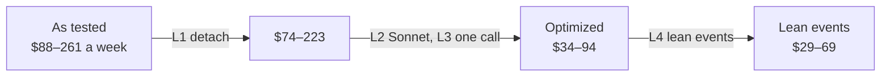

# Design 5 on Claude Desktop: optimization and cost detail

[TOC]

- **Design:** [01-design.md](01-design.md), the Claude Desktop variant only.
- **Model:** [evidence/scripts/cost_model.py](evidence/scripts/cost_model.py); every figure
  below comes from it.
- **Measured inputs:** [evidence/tests-2026-10-31.md](evidence/tests-2026-10-31.md) (Foreman
  and Driver calls on Desktop), design 2's prices and per-role costs, design 1's dynamic workflow
  estimate.

:::{important} Verdict
Optimized, design 5 costs **$29–69 a week** for orchestration with lean events, or $34–94 with
every Driver milestone sent to the Foreman. That is **$0.26–0.65 per CR**. The dynamic
workflow of design 1 costs **$24–137 a week**, $0.25–1.46 per CR. The two overlap: design 5 is
**as cheap as the workflow and more predictable**, because its biggest unknown, the judge, does
not exist in design 5. Against today's orchestration, about $270–300 a week, design 5 saves three quarters or more
and the workflow half or more.

Design 5 as tested, an Opus Foreman left attached to the Chief of Staff, costs $88–261 a week.
Five levers close the gap; none of them needs a new Claude Code feature.
:::

## 1. Scope and volume

- **Orchestration only:** Foreman, Drivers, stack driver, and the Chief of Staff's turns caused
  by the batch. Coders and Inspectors do the same work in every design and are left out. The
  dynamic workflow's extra Coder rounds are counted, because design 1 causes them.
- **Volume:** about **94 CRs a week**, design 1's count over the runs of 2026-10-17 to 27.
- **Prices:** official rates in $/MTok. Opus 5.5: 4 input, 8 one-hour write, 0.20 read, 20
  output. Sonnet 5.5: half of each. Haiku 5.5 for the workflow's runners.
- **Today, for scale:** orchestration roles $181–215 a week (design 2), plus $85 of orchestration
  in the main session: about **$270–300 a week**.

## 2. The five levers on Claude Desktop

From design 5 as tested to design 5 optimized. Each lever is a setting or a rule in the skill.

| # | Lever | How | Measured basis | Effect |
| --- | --- | --- | --- | --- |
| L1 | **Detach the Foreman** | `detach_session` right after `start_session` | one app note per Foreman turn, $0.030–0.050 each | −$14–38 a week |
| L2 | **Foreman on Sonnet, low effort** | `start_session` with `model: claude-sonnet-5-5`, `effort: low` | Sonnet is half of Opus on every price | Foreman −50 % |
| L3 | **One `crf event` call per Driver event** | the Foreman passes the report to `crf`, which returns the action; reply in one line | Desktop Foreman made 3–4 calls per event in the tests | Foreman −40–60 % |
| L4 | **Lean events** | Drivers write routine milestones with `crf report`; they message the Foreman only for a hand-back, a question or an anomaly | 5–8 Foreman events per CR → 2–3 | Foreman −60 % |
| L5 | **Driver agent file, one-hour cache** | `.claude/agents/driver.md`, Sonnet, `experimental.cacheTtl: 1h`, `crf wait --max 3300` | measured: 17–20k prefix, one-hour writes only | in the Driver line; no re-arm notices |

Two more were checked and left aside:

- **A smaller Foreman prefix.** The Desktop prefix is 70k. Turning off the session's connectors
  might trim it, but at Sonnet's read price each 10k tokens saves about $0.001 a call: $1–2 a
  week. Worth one spike, not a rule.
- **A faster heartbeat.** A tick every 59 minutes costs $0.4–1.1 a week. A shorter tick only
  adds cost; Driver events already wake the Foreman.



## 3. Cost detail per role

Per CR and per week at 94 CRs. Low and high cases come from the ranges in each row's basis.

```{list-table} Design 5 on Claude Desktop, optimized, with lean events
:header-rows: 1
:widths: 22 40 19 19

* - Part
  - Basis
  - Per CR
  - Per week
* - Foreman events
  - Sonnet, 70–110k context, $0.012–0.019 per call; 1.2–2 calls per event; 2–3 events per CR (hand-back, a question, an order)
  - $0.03–0.11
  - $3–10
* - Foreman starts and heartbeat
  - 70k prefix written once per batch, 15–25 batches; one tick per active batch hour, 30–60 hours
  - –
  - $5–8
* - Drivers
  - Sonnet, 17–20k prefix written once; 8–10 turns per CR at $0.011–0.025 (design 2's turn count with `crf`)
  - $0.16–0.33
  - $15–31
* - Stack driver
  - design 2 after levers, $3.4–8.9 a week
  - $0.04–0.09
  - $3–9
* - Chief of Staff
  - 0.7–1.2 Foreman messages per CR (PR links batched per stack), $0.05–0.10 a wake (measured $0.069 at 108k)
  - $0.03–0.12
  - $3–11
* - **Total**
  -
  - **$0.26–0.65**
  - **$29–69**
```

Without L4, the Foreman takes every Driver milestone: 5–8 events per CR, $0.07–0.30 per CR,
and the Chief of Staff 1–2 messages per CR. The total is then **$34–94 a week**.

**Where the money goes.** The Drivers are now half of the bill. They are the agents that run the
rounds, ship and watch CI, and their cost follows design 2's turn count. The Foreman, which was
the largest line as tested, falls by more than 90 %.

## 4. Against the dynamic workflow

Design 1 replaces the Foreman and the Drivers with a workflow script over `crf`. Its LLM parts
are Haiku runners that call `crf`, a judge started per decision, and the Chief of Staff.

```{list-table} Dynamic workflow, design 1, section 12
:header-rows: 1
:widths: 22 40 19 19

* - Part
  - Basis
  - Per CR
  - Per week
* - `crf` runners
  - Haiku, 8–10 calls per CR at $0.005–0.01
  - $0.04–0.10
  - $4–9
* - Judge
  - 60–150 decisions a week at $0.20–0.50; the count is not measured
  - $0.13–0.80
  - $12–75
* - Chief of Staff
  - one short turn per event on a bounded context
  - $0.03–0.11
  - $3–10
* - Extra Coder rounds
  - failures a Driver fixed itself become a fresh Coder round, $0.42–0.69 each, 13–67 a week
  - $0.05–0.46
  - $5–43
* - **Total**
  -
  - **$0.25–1.46**
  - **$24–137**
```

```vega-lite
width: 520
height: 200
data:
  values:
    - {design: "Today (orchestration)", low: 270, high: 300}
    - {design: "Design 5, as tested", low: 88, high: 261}
    - {design: "Design 5, optimized", low: 34, high: 94}
    - {design: "Design 5, lean events", low: 29, high: 69}
    - {design: "Dynamic workflow", low: 24, high: 137}
encoding:
  y: {field: design, type: nominal, sort: null, title: null}
layer:
  - mark: {type: bar, color: "#C9E8CF"}
    encoding:
      x: {field: high, type: quantitative, title: "Orchestration per week, dollars (low dark, high light)"}
  - mark: {type: bar, color: "#46a758"}
    encoding:
      x: {field: low, type: quantitative}
```

### 4.1 What the dollars buy

| | Design 5, lean events | Dynamic workflow |
| --- | --- | --- |
| Orchestration per week | $29–69 | $24–137 |
| Largest uncertainty | Driver turns per CR (design 2 measured them) | judge decisions per week (not measured) |
| Talk to the batch | the Foreman answers in 15–54 s | no one: the Chief of Staff edits `crf` state |
| A change to a running CR | the Driver decides: steer, restart or defer | applied at the next step boundary |
| A failing suite or CI | the Driver fixes it in its round | a fresh Coder round, $0.42–0.69 |
| Steering a running Coder | after its round | not possible |
| Your session | free; wakes on PR links and questions | free; wakes on each event that needs you |
| Cost ceiling | none built in; `crf` can count and stop | one per run in the workflow limits |
| Built and tested | Desktop sessions tested 2026-10-31; `crf event`, `crf report` to build | set aside on 2026-10-27; workflow and judge to build |
| Hosts | Claude Desktop; Copilot with one probe left | Claude Code workflows; Copilot dynamic workflows (design 4, series 07) |

:::{note} Reading the comparison
The low ends are close ($29 and $24): both designs have cut almost every LLM turn that a rule can
take. At the
high end the workflow pays for a judge it calls often, and for Coder rounds a Driver would have
saved. Design 5's high end is set by Drivers that need more turns than design 2 measured.
:::

## 5. Assumptions to measure

| Assumption | Used | How to check |
| --- | --- | --- |
| A Sonnet Foreman decides as well as Opus | L2 | the first real batch; escalate to the Chief of Staff on doubt |
| One `crf event` call per Driver event | L3 | count calls per event in the first batch |
| 2–3 Foreman events per CR with `crf report` | L4 | `crf` logs events by kind |
| 8–10 Driver turns per CR | Driver line | design 2 measured 11 today, 5 of them mechanical |
| 15–25 batches and 30–60 batch hours a week | starts, ticks | `crf` history |
| 94 CRs a week | every weekly figure | the same window as designs 1 to 3 |

## 6. Recommendation

1. **Ship design 5 on Claude Desktop with L1 to L5.** Detach, Sonnet low effort, one `crf event`
   call, lean events, the Driver agent file.
2. **Unattended batches are a separate decision.** A night batch started by cron has no user
   turn to start a session in, so design 5's preflight fails for it and nothing runs. The
   dynamic workflow could serve that case, but only if you choose it; it is never an automatic
   fallback ([01-design.md, preflight](01-design.md)).
3. **Measure one real batch of 2–3 CRs** with [cost_model.py](evidence/scripts/cost_model.py)'s
   inputs logged, and replace the estimates.
